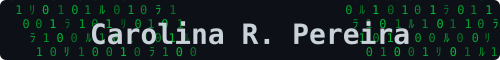

[🇺🇸](./README.md) | 🇪🇸

# Carolina R. Pereira

**Product Manager & Desarrolladora de Software**

Co-fundadora de [Axiom](https://axiom.co/) · Ex Docente de Programación en [UTEC Uruguay](https://utec.edu.uy/es/)

 

---

## Sobre mí

- 🚀 **Construyo** productos de punta a punta: desde el discovery y el roadmap hasta código en producción.
- 🧠 **Especializada** en Inteligencia Artificial y Ciberseguridad, con dos másteres oficiales que lo respaldan.
- 🎓 **Enseñé** programación a nivel universitario, convirtiendo conceptos complejos en habilidades que la gente realmente usa.
- ✍️ **Comparto** lo que aprendo en [Medium](https://medium.com/@carolina.r.pereira) y [YouTube](https://www.youtube.com/@CarolinaRPereira).

---

## Formación

| Título | Institución | |
|---|---|---|
| **Máster Oficial en Inteligencia Artificial** (RVOE Nº 20200729) | [UNIR](https://mexico.unir.net/ingenieria/maestria-inteligencia-artificial/) | 🇲🇽 🇪🇸 |
| **Máster Oficial en Ciberseguridad** (RVOE Nº 20232524) | [UNIR](https://mexico.unir.net/ingenieria/maestria-seguridad-informatica/) | 🇲🇽 🇪🇸 |
| **Licenciatura en Tecnologías de la Información** | [UTEC](https://utec.edu.uy/es/) | 🇺🇾 |

---

## Stack Tecnológico

**Backend**

**Frontend**

**DevOps y Herramientas**

---

## Actividad en GitHub

  

---

## Hablemos

Abierta a conversar sobre producto, IA, seguridad y educación para desarrolladores.
La forma más rápida de contactarme es por [LinkedIn](https://www.linkedin.com/in/carolinarpereira/).

 

*Del aula a producción. De la investigación a la realidad.*
 
*No solo escribimos código. Lo enseñamos, lo enviamos, lo hacemos avanzar.*

